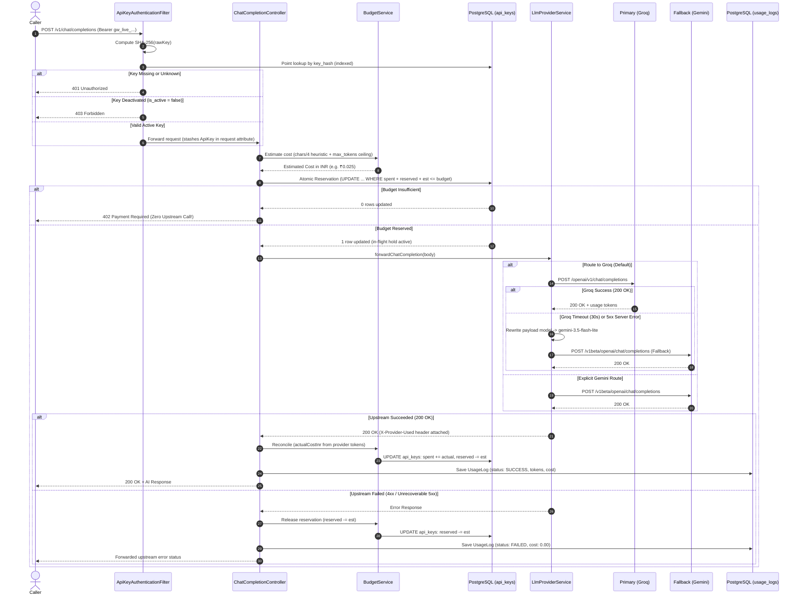

# Architecture & Design Decisions: Minimal LLM Gateway

**Author**: Anikesh  
**Project**: Minimal LLM Gateway (Backend Engineering Take-Home)  
**Deployed URL**: [https://llm-gateway-2v9l.onrender.com](https://llm-gateway-2v9l.onrender.com)  
**Primary Provider**: Groq Cloud (`https://api.groq.com/openai/v1`) — Model: `openai/gpt-oss-20b`  
**Fallback Provider**: Google Gemini (`https://generativelanguage.googleapis.com/v1beta/openai`) — Model: `gemini-3.5-flash-lite`  

---

## 1. What I Built

A production-grade, lightweight HTTP LLM Gateway developed in Java 21 and Spring Boot 3.3.5 that sits between external callers and upstream LLM providers (Groq and Google Gemini). 

The gateway enforces:
1. **Virtual API Keys**: Callers never see or possess real provider credentials. Keys are issued with 256 bits of CSPRNG entropy (`gw_live_<64-hex>`) and stored strictly as one-way SHA-256 hashes in PostgreSQL.
2. **Pre-Call Atomic Budget Enforcement in INR ($\text{₹}$)**: Using a single conditional SQL update in PostgreSQL, the gateway reserves an estimated cost before making any external provider call. If a key has insufficient funds, it halts immediately with `HTTP 402 Payment Required` with zero provider egress.
3. **Multi-Provider Fallback & Resilience**: Routes to Groq by default; automatically fails over to Google Gemini upon primary 5xx server errors or socket timeouts (30s threshold), rewriting the model payload on the fly.
4. **Persistent Usage & Spend Auditing**: Synchronously records per-request token usage and calculated INR cost in PostgreSQL, settlement of in-flight reservations, and instant spend inquiries via `GET /usage?key=...`.

---

## 2. Request Lifecycle

The diagram below outlines the exact lifecycle of every inbound request:



---

## 3. Key Architectural Decisions & Trade-Offs

### Decision 1: Budget Unit — Currency in INR ($\text{₹}$) with Fixed-Point Arithmetic
* **Context**: Gateways must enforce limits across heterogeneous models with vastly different price points.
* **Options Considered**:
  1. *Request Count*: Simplest, but treats a 10-token prompt on an 8B model identically to a 4,000-token prompt on a 120B model.
  2. *Token Count*: Better, but ignores that 1,000 output tokens on a reasoning model can cost $10\times$ more than on a lightweight model.
  3. *Currency in INR ($\text{₹}$)*: Calculates exact cost using the standard formula:
     $$\text{Total Cost} = \left(\frac{I \times P_i}{1{,}000{,}000} + \frac{O \times P_o}{1{,}000{,}000}\right) \times \text{USD\_INR}$$
* **Decision**: Currency in INR ($\text{₹}$) using `NUMERIC(14, 6)` in PostgreSQL and `BigDecimal` in Java.
* **Trade-Off**: Fractional currency requires careful fixed-point handling and a pricing catalog, but reflects real-world cloud economics accurately.

### Decision 2: Spring MVC (Blocking) + `RestClient` vs. WebFlux (Reactive)
* **Context**: Technology stack for HTTP handling and provider dispatch.
* **Options Considered**:
  1. *Spring WebFlux (Reactive / Netty)*: Asynchronous non-blocking I/O.
  2. *Spring MVC (Blocking) + Spring 6 `RestClient` on Java 21*: Synchronous thread-per-request model.
* **Decision**: Spring MVC with `RestClient`.
* **Trade-Off**: While reactive I/O handles idle socket waits with fewer OS threads, PostgreSQL JDBC/JPA is inherently blocking. Mixing reactive web pipelines with blocking database calls creates thread-starvation antipatterns unless complex R2DBC drivers are used. Java 21 allows virtual-thread readiness without reactive complexity.

### Decision 3: Cryptographic One-Way Key Hashing (SHA-256)
* **Context**: Virtual API key storage and lookup security.
* **Options Considered**:
  1. *Plaintext Storage*: Unacceptable. Any database dump or SQL injection exposes caller keys.
  2. *Symmetric Encryption (AES-256)*: Reversible, but introduces master key management risk and is unnecessary because the gateway only needs to verify keys, never retrieve them.
  3. *SHA-256 Digest*: Irreversible cryptographic hash.
* **Decision**: Prefixed 256-bit token (`gw_live_<64-hex>`). Only the SHA-256 hex digest is stored in a unique index in PostgreSQL.
* **Trade-Off**: Lost keys cannot be recovered by admins; a new key must be reissued.

### Decision 4: Synchronous Fail-Closed Audit Logging
* **Context**: Recording per-request metrics in `usage_logs`.
* **Options Considered**:
  1. *Asynchronous Background Logging (Kafka / In-Memory Queue)*: Non-blocking, but risks losing audit logs during process crashes and creates eventual-consistency lag on spend queries.
  2. *Synchronous In-Transaction Logging*: Persists the audit record in the same request thread.
* **Decision**: Synchronous database write with fail-closed semantics (returns HTTP 500 if the database write fails).
* **Trade-Off**: Adds minor database write latency ($\sim 2\text{--}5\text{ms}$) to the request path, but guarantees zero dropped audit logs and immediate consistency for `GET /usage`.

---

## 4. Why Enforce Budgets at the Gateway?

Enforcing budgets at the gateway level is an architectural necessity:
1. **Callers Cannot Be Trusted**: Upstream clients are untrusted microservices, frontend applications, or external developers. Self-regulation is impossible in multi-tenant environments.
2. **Upstream Providers Bill Post-Facto**: Upstream LLM providers (Groq, OpenAI, Google) bill after completion tokens are generated. They do not enforce arbitrary per-user sub-budgets.
3. **Provider-Agnostic Abstraction**: In a multi-provider gateway routing across Groq and Gemini, neither provider has visibility into what the client spent on the other. The gateway is the **sole mandatory chokepoint** capable of enforcing unified financial ceilings.

---

## 5. Concurrency on a Near-Exhausted Key (The "Double Spend" Race)

### The Problem
Suppose a virtual key has $\text{₹}1.00$ remaining. Two requests (Req A and Req B) arrive simultaneously, each estimated at $\text{₹}0.80$.
* *The Naive Approach (Read-Then-Write)*:
  1. Thread A executes `SELECT remaining ...` $\rightarrow$ reads $\text{₹}1.00$.
  2. Thread B executes `SELECT remaining ...` $\rightarrow$ reads $\text{₹}1.00$.
  3. Both threads check application memory: `0.80 <= 1.00` $\rightarrow$ both evaluate `true`.
  4. Both threads dispatch to the LLM provider.
  5. Both calls succeed. Total spent = $\text{₹}1.60$.
  6. **Result**: An uncontrolled overspend of $60\%$.

### The Solution: Single Atomic Conditional Update
We eliminate application-level read-then-write by delegating concurrency control to PostgreSQL's row-level lock via a single native SQL query:

```sql
UPDATE api_keys
SET reserved_inr = reserved_inr + :estimatedCost,
    updated_at   = NOW()
WHERE id = :id 
  AND is_active = TRUE 
  AND (spent_inr + reserved_inr + :estimatedCost) <= budget_inr;
```

* **Mechanism**: When concurrent requests target the same `id`, PostgreSQL serializes them on the row lock.
* Thread A updates the row: `reserved_inr` becomes $\text{₹}0.80$, returning `1 row affected`. Thread A proceeds.
* Thread B acquires the lock next: `spent (0.00) + reserved (0.80) + est (0.80) = 1.60 > 1.00`. The `WHERE` condition fails. PostgreSQL returns `0 rows affected`.
* The gateway halts Thread B immediately and returns **`HTTP 402 Payment Required`** without contacting the provider.
* **Automated Proof**: Tested in `BudgetConcurrencyIntegrationTest.java` with 10 parallel threads competing for a budget of 1 request. Exactly 1 succeeded (200 OK) and exactly 9 were rejected with 402.

---

## 6. Fallback & Resilience Policy

The gateway follows **bounded failover with strict HTTP semantic awareness**:

```
                       Inbound Request
                              │
                      [Primary: Groq]
                              │
            ┌─────────────────┴─────────────────┐
      Status 200 OK                       Status 4xx / 5xx / Timeout
            │                                   │
     Reconcile Tokens                 ┌─────────┴─────────┐
     & Return Response                │                   │
                                4xx (Bad Request)    5xx / Timeout (30s)
                                      │                   │
                                Fast-Fail           [Fallback: Gemini]
                                (Do NOT retry)      (Rewrite model to gemini-3.5-flash-lite)
                                Release Hold              │
                                                    ┌─────┴─────┐
                                                  200 OK      5xx/Fails
                                                    │           │
                                                Reconcile    502 Bad Gateway
                                                Tokens       Release Hold
```

1. **Fast-Fail on 4xx**: Client errors (`400 Bad Request`, `404 Model Not Found`) are **never retried**. Retrying a malformed request on a second provider wastes money and adds latency to an inherently invalid payload.
2. **Failover on 5xx & Timeouts**: If Groq returns a `500/502/503` or exceeds the `30,000 ms` read timeout (`ResourceAccessException`), `attemptFallback()` automatically triggers.
3. **Payload Rewriting**: Upstream providers do not share model catalogs. The gateway dynamically rewrites the `"model"` property in the request JSON to `gemini-3.5-flash-lite` before dispatching to Google.
4. **Fail-Safe Release**: If both primary and fallback fail, the gateway resets `reserved_inr` and records `status: FAILED` with $\text{₹}0.000000$ cost.

---

## 7. What I Explicitly Did NOT Build

To maintain focused engineering execution within take-home time constraints, the following were intentionally omitted:
1. **Streaming (SSE / Chunked Transfer)**: Token settlement requires knowing exact token counts. Non-streaming first establishes bulletproof atomic accounting before addressing chunk-level estimation.
2. **Distributed Redis Rate Limiting**: PostgreSQL row-level locks handle hundreds of concurrent requests per key cleanly. Introducing Redis would add an external dependency and split-brain risk without necessity at this stage.
3. **Kafka / Asynchronous Event Bus**: Added operational overhead without architectural necessity. Synchronous database writes guarantee immediate consistency for spend queries.
4. **Multi-Tenant RBAC**: The gateway authenticates virtual keys and admin tokens; full user hierarchies belong in an identity provider (e.g. Keycloak/Auth0).

---

## 8. Least-Confident Decision (Evaluated from Both Sides)

**Decision**: Using prompt character count heuristic ($\lceil \text{chars}/4 \rceil$) + `max_tokens` ceiling for pre-call cost reservation.

* **Arguments For (Why I Chose It)**:
  - Tokenizers (BPE / tiktoken / SentencePiece) are model-specific, memory-intensive, and C/Python-native. Embedding multiple heavy Java tokenizer bindings for different model families slows down the gateway.
  - $\lceil \text{chars}/4 \rceil$ is universally accepted as a tight approximation for English text.
  - Coupled with clamping `max_tokens` to `MAX_TOKENS_CEILING` (4,096), it guarantees a deterministic maximum financial exposure before the call.
* **Arguments Against (The Weakness)**:
  - For non-English languages (e.g. Hindi, Japanese, Arabic) or dense source code, 1 token may only represent $1\text{--}1.5$ characters. The $\lceil \text{chars}/4 \rceil$ formula can underestimate prompt tokens by up to $3\times$.
  - If a key has very low budget and the prompt is in a non-Latin script, the pre-reservation might reserve less than the true actual cost, allowing a small overspend during post-call settlement.

---

## 9. Where It Breaks & What I Would Build With One More Week

### Where It Breaks Under Scale
1. **Row-Lock Contention on a Single Shared Key**: If 500 concurrent client threads make calls using the exact same virtual key, all 500 transactions queue on the same PostgreSQL row lock in `api_keys`. This creates database connection pool exhaustion and elevated p99 latency.
2. **Database Write Pressure**: Synchronously inserting a `usage_logs` record on every single request bounds gateway throughput to the PostgreSQL write IOPS (typically $\sim 1{,}000\text{--}3{,}000\text{ req/sec}$).

### What I Would Build With One More Week
1. **Redis Token-Bucket Pre-Reservation**: Migrate the hot in-flight reservation counter (`reserved_inr`) to a Redis Lua script for sub-millisecond atomic checks, syncing settled totals back to PostgreSQL asynchronously via a transactional outbox.
2. **Streaming Support (SSE)**: Implement chunk-by-chunk proxying with dynamic token estimation, closing the stream immediately if a client's budget cap is breached mid-sentence.
3. **Exact Server-Side Tokenizer Cache**: Integrate a lightweight HuggingFace tokenizers JNI binding to compute exact prompt token counts for major model families prior to reservation.
4. **Automated Budget Top-Up Webhook**: Emit an HTTP webhook notification when `remainingBudgetInr < 10%` to alert account owners before exhaustion.
